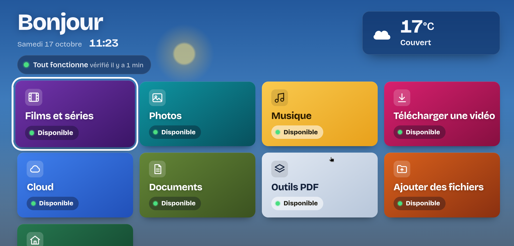
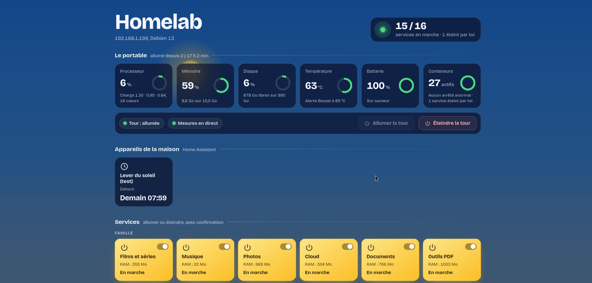
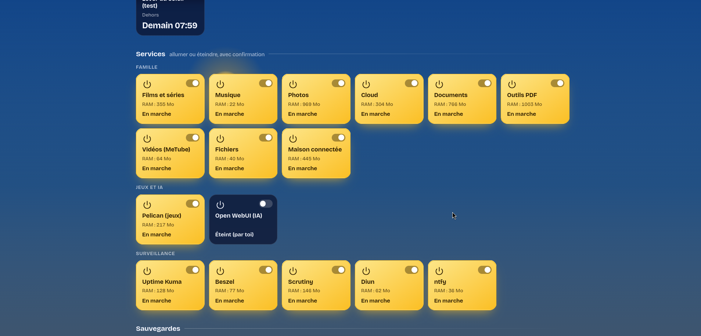

# Homelab familial sur un vieux portable

Un serveur maison complet qui tourne sur **un seul portable sous Debian 13** (allumé en permanence, écran éteint), avec une vingtaine de services en conteneurs Docker, deux pages d'accueil faites à la main (une pour la famille, une pour l'administrateur) et une sauvegarde chiffrée chaque semaine vers un autre PC de la maison.

Tout est en français, pensé pour une famille : des noms simples en `.lan` (`films.lan`, `photos.lan`, `cloud.lan`…), et un accès à distance par VPN (Tailscale).

> Les noms, adresses, domaines et identifiants de ce dépôt sont des **exemples**. La partie « À remplacer » ci-dessous liste tout ce que tu dois adapter.

---

## Ce que fait le projet

| Usage | Service | Adresse |
|---|---|---|
| Films et séries | Jellyfin | `films.lan` |
| Musique | Navidrome | `musique.lan` |
| Photos du téléphone | Immich | `photos.lan` |
| Fichiers, agenda, contacts | Nextcloud | `cloud.lan` |
| Papiers scannés (OCR) | Paperless-ngx | `docs.lan` |
| Outils PDF | Stirling PDF | `pdf.lan` |
| Télécharger des vidéos | MeTube | `videos.lan` |
| Gestionnaire de fichiers web | File Browser | `fichiers.lan` |
| Maison connectée | Home Assistant | `domotique.lan` |
| Serveurs de jeux | Pelican Panel + Wings | `jeux.lan` |
| IA locale | Ollama + Open WebUI (démarrage à la demande) | `ia.lan` |
| Bloqueur de pubs et DNS `.lan` | AdGuard Home | `dns.lan` |
| Disponibilité et alertes mail | Uptime Kuma | `status.lan` |
| Ressources du serveur | Beszel | `monitor.lan` |
| Santé des disques | Scrutiny | `disque.lan` |
| Journaux des conteneurs | Dozzle | `logs.lan` |
| Gestion Docker | Portainer | `docker.lan` |
| Notifications sur le téléphone | ntfy | `notif.lan` |
| Mises à jour d'images disponibles | Diun | (notifications) |
| Page famille | page statique + `api.py` | `home.lan` |
| Page administrateur | page statique + `api.py` | `admin.lan` |

**Pages maison** : deux pages web faites à la main, décrites plus bas (« Les deux pages web »).

**Service local `homelab-api`** (`caddy/api.py`, Python standard, aucune dépendance) : écoute sur `127.0.0.1:8095`, sert `/api/*` aux deux pages, écrit `etat.json` toutes les 30 s, et expose `/api/sante/<service>` pour Uptime Kuma : un service **éteint volontairement** depuis l'admin reste « sain » (pas de mail), une vraie panne déclenche un mail après 30 min puis un mail « rétabli ».

**Robustesse** :
- `bin/garde-fou.sh` (toutes les 2 min) relance un conteneur arrêté ou « unhealthy », 3 fois par heure au plus, avec notification ntfy. Il ne relance jamais un service éteint depuis l'admin (liste `~/.config/homelab/conteneurs-eteints`, écrite par `api.py`), et se contente d'une alerte pour Caddy et AdGuard ;
- `installation/recharger-caddy-sur.sh` valide et recharge Caddy, et remet la dernière version qui marchait si un test échoue ;
- `bin/verifier-apres-redemarrage.sh` vérifie tout en lecture seule après un redémarrage ;

**Sécurité** : services derrière Caddy, mot de passe Caddy sur les outils sans connexion, https par une autorité de certification locale (`tls internal`), HSTS d'un jour sur les `.lan` en https, aucun secret dans les fichiers du dépôt. Le pare-feu et l'accès SSH sont à régler selon ta propre installation : leur configuration réelle n'est pas publiée.

---

## Les deux pages web

Deux pages statiques (HTML, CSS et JavaScript dans un seul fichier chacune, sans framework ni ressource externe sauf la météo), servies par Caddy. Les polices sont dans `fonts/` à côté de chaque page.

### Accueil de la famille : `home.lan` (`caddy/pages/home/`)


- **Tuiles par usage**, rangées en trois groupes : « Regarder et écouter » (Films, Musique, Photos, Vidéos), « Papiers et fichiers » (Cloud, Documents, Outils PDF, Ajouter des fichiers) et « La maison » (Maison connectée).
- **État de chaque service** sous sa tuile : « Disponible », « Éteint pour le moment » (éteint volontairement par l'administrateur), ou en panne. Un résumé en haut, par exemple « Tout fonctionne · 1 éteint pour le moment ». L'état est lu dans `etat.json`, réécrit toutes les 30 s par `homelab-api`.
- **Météo du jour** (Open-Meteo, sans compte ni clé).
- **Mode télé** : détecté automatiquement, ou forcé avec `?tv=1` (`?tv=0` pour l'enlever). La page est lisible à 3 mètres et se parcourt avec les flèches de la télécommande.
- **Https automatique** : en http, la page teste discrètement `https://<même nom>/sonde-https.png`. Si l'appareil a le certificat, elle passe en https ; sinon elle reste en http, sans page d'erreur, et ne réessaie pas avant 3 jours. `?http=1` force le http.
- **`certificat.html`** : installation du certificat de l'autorité locale. La page détecte l'appareil (Windows, Mac, Linux, iPhone/iPad, Android), propose le bon fichier et affiche l'empreinte SHA-256 à comparer. Les fichiers du certificat sont générés par `caddy/generer-certificat.sh` et ne sont pas dans le dépôt.
- **`guide.html`** : mode d'emploi pour la famille : premiers pas, chaque service, tablette et télé, accès depuis l'extérieur, et quoi faire si ça ne marche pas.



### Administration : `admin.lan` (`caddy/pages/admin/`)

Protégée par le mot de passe Caddy (`basic_auth`). Toutes les actions passent par `homelab-api` (`/api/*`), qui exige l'en-tête `X-Homelab: 1`.



- **Le portable** : processeur, mémoire, disque, température, conteneurs (« Aucun arrêté anormal · N éteint(s) par toi »). Le badge du haut indique le nombre de services en marche sur le total (par exemple 15 / 16 · 1 éteint par toi) ; il passe au rouge seulement en cas de vraie panne.
- **Appareils de la maison** : lumières et prises de Home Assistant, plus le bouton **« Allumer la tour »** (Wake-on-LAN) et **« Éteindre la tour »** (SSH avec une clé dédiée).
- **Services** : un interrupteur par service (16), rangés par groupes, avec une fenêtre de confirmation et la **mémoire (RAM)** utilisée sous chaque fiche.
  - Un service éteint ici le reste après un redémarrage, et Uptime Kuma n'envoie pas d'alerte pour lui.
  - Pendant un démarrage, la fiche affiche « Démarrage… ».
  - Un service n'est déclaré « Tombé » qu'après 2 vérifications échouées d'affilée.
- **Sauvegardes** : bouton « Sauvegarder maintenant », historique des exécutions (Réussie, Ignorée ou Échec, avec la raison lue dans le journal), journal de chaque exécution et liste des instantanés restic.
- **Outils et raccourcis** : liens vers les interfaces d'administration (AdGuard, Portainer, Kuma, Beszel, Dozzle, Scrutiny…), création de comptes Jellyfin et Navidrome, gestionnaire de fichiers, ajout de vidéos.



### Captures d'écran

Les images vont dans **`docs/images/`** (voir `docs/images/LISEZ-MOI.md` pour les noms attendus). **Attention** : prends-les sur une page qui n'affiche ni prénom réel, ni adresse, ni domaine personnel. Le script de publication vérifie le texte, mais il ne peut pas lire les images.

---

## Architecture

```
            Appareils de la maison                     À distance (téléphone, PC du travail)
         (tour, télé, téléphones, tablettes)                         │
                      │  DNS = AdGuard (le portable)                 │  Tailscale (split DNS « lan »)
                      ▼                                              ▼
   ┌──────────────────────────── Portable Debian 13 (192.168.1.199) ─────────────────────────────┐
   │  pare-feu                                                                                   │
   │  AdGuard Home  ── *.lan → 192.168.1.199                                                     │
   │  Caddy (:80/:443, tls internal) ── home.lan / admin.lan → pages statiques + /api → :8095    │
   │        │                         ── films.lan → 127.0.0.1:8096, photos.lan → …, etc.        │
   │        ▼                                                                                    │
   │  homelab-api (systemd --user, 127.0.0.1:8095) ── docker ps / stats, Home Assistant, WoL     │
   │  Conteneurs Docker : Jellyfin, Immich, Nextcloud, Paperless, … (un dossier par service)     │
   │  Uptime Kuma ── /api/sante/<id> ── mail (Gmail)        ntfy ── téléphone                    │
   │  homelab-backup.timer (samedi 17 h) ── restic chiffré ──────────┐                           │
   └─────────────────────────────────────────────────────────────────┼───────────────────────────┘
                                                                     ▼
                                          Tour Windows (192.168.1.198) : partage SMB « Sauvegardes-homelab »
                                          réveillée par Wake-on-LAN, éteinte par SSH avec une clé dédiée
```

Nom public facultatif : un domaine **DuckDNS** (`exemple.duckdns.org`) qui pointe vers l'**adresse privée** du portable. Il sert seulement aux appareils connectés par Tailscale ou au réseau local ; rien n'est exposé sur Internet.

### Arborescence

```
<service>/docker-compose.yml   un dossier par service (+ .env.example quand il faut des secrets)
caddy/                         Caddyfile, api.py, pages home et admin, certificat, scripts Caddy
bin/                           garde-fou, mise à jour DuckDNS, vérification après redémarrage, scripts d'installation
sauvegarde/                    script restic du samedi et son installation
installation/                  installation des pages, de l'interface de sauvegarde, rechargement sûr de Caddy
systemd/utilisateur/           homelab-api, garde-fou, duckdns-maj (services --user)
systemd/systeme/               homelab-backup.service, .timer et son complément
outils/                        scripts Uptime Kuma (sondes), règle Firefox pour le certificat
docs/                          guide d'installation complet
docs/images/                   captures d'écran des pages (accueil, télé, admin, services)
```

---

## Installation

Le guide pas à pas complet est dans **`docs/homelab-guide.md`** (phases 0 à 23). En résumé :

1. **Système** : Debian 13 minimal, utilisateur avec `sudo`, plus de mise en veille (couvercle compris), zram, mises à jour de sécurité automatiques (`bin/rattrapage.sh` et `bin/phase3.sh` montrent les commandes). Adresse fixe pour le portable (bail DHCP réservé dans la box).
2. **Docker** : Docker Engine + plugin compose ; ajoute ton utilisateur au groupe `docker`.
3. **Copier le dépôt** dans `~/homelab` (les scripts supposent ce chemin).
4. **Secrets** : pour `immich`, `nextcloud` et `paperless`, copie `.env.example` en `.env` et remplace chaque `A_REMPLACER` (ex. `openssl rand -hex 20`). Ces `.env` ne doivent jamais être publiés (voir `.gitignore`).
5. **AdGuard Home** (`adguard/`) : lance-le, fais l'assistant sur le port 3000, puis ajoute une réécriture DNS `*.lan → <IP du portable>`. Dans la box, donne l'IP du portable comme DNS principal.
6. **Caddy** (`caddy/`) : adapte le `Caddyfile` (domaine, adresses IP de tes appareils), puis définis le mot de passe admin avec `bash caddy/set-admin-password.sh` (il remplace le hachage d'exemple). Génère les fichiers du certificat avec `bash caddy/generer-certificat.sh` une fois Caddy démarré.
7. **Services** : dans chaque dossier, `docker compose up -d`. Crée les comptes administrateurs **toi-même** dans chaque interface.
8. **Pages et `homelab-api`** : `bash installation/installer-pages.sh` (sans sudo), puis copie `systemd/utilisateur/*` dans `~/.config/systemd/user/` et `systemctl --user enable --now homelab-api garde-fou.timer duckdns-maj.timer`. Pense à `loginctl enable-linger <utilisateur>` pour que les services utilisateur démarrent sans connexion.
9. **Sauvegarde** : prépare le partage SMB sur l'autre PC, puis `sudo bash sauvegarde/installer-sauvegarde.sh` et `sudo bash installation/installer-sauvegarde-ui.sh`. Crée **toi-même** `/root/.smb-tour` (identifiants du partage) et `/root/.restic-pass` (mot de passe de chiffrement, à garder aussi hors du portable), puis `sudo restic-homelab init`.
10. **Sécurité et accès à distance** : pare-feu, accès SSH et VPN selon ton installation (principes dans `docs/homelab-guide.md`, phases 16 et 18). Tailscale : annonce de route vers l'IP du portable et split DNS `lan`.
11. **Uptime Kuma** : crée une notification mail, puis une sonde HTTP par service vers `http://127.0.0.1:8095/api/sante/<id>` (30 essais × 60 s). Les scripts de `outils/kuma/` montrent comment le faire directement dans la base, Kuma arrêté.
12. **Vérifier** : `bash bin/verifier-apres-redemarrage.sh`.

Règle d'or suivie partout : **aucun mot de passe ni jeton ne passe par un fichier du dépôt ni par un chat**. Les secrets sont tapés dans un terminal avec `read -s` et écrits dans des fichiers en droits 600.

---

## À remplacer par tes propres valeurs

| Quoi | Valeur d'exemple dans le dépôt | Où |
|---|---|---|
| Utilisateur Linux et dossier personnel | `alex`, `/home/alex` | `systemd/`, `bin/`, `sauvegarde/`, `caddy/api.py`, `docker-compose.yml` (volumes), docs |
| Prénoms des comptes de la famille | `Alex` (admin), `camille`, `sam` | docs, `outils/kuma/` |
| Domaine DuckDNS | `exemple.duckdns.org` | `caddy/Caddyfile`, `bin/duckdns-maj.sh`, `systemd/utilisateur/duckdns-maj.*`, pages home et admin |
| Jeton DuckDNS | aucun dans le dépôt | à écrire toi-même dans `~/.config/homelab/duckdns-token` (600) |
| Adresse du portable | `192.168.1.199` | `Caddyfile`, `nextcloud` (`NEXTCLOUD_TRUSTED_DOMAINS`), `duckdns-maj.sh`, `verifier-apres-redemarrage.sh` |
| Adresses de tes appareils en https forcé | `192.168.1.198` (tour), `192.168.1.71` (téléphone) | `Caddyfile` (`https_mes_appareils`) |
| Adresse de la tour de sauvegarde, nom du partage | `192.168.1.198`, `Sauvegardes-homelab` | `sauvegarde/`, `caddy/api.py`, `bin/verifier-apres-redemarrage.sh` |
| Adresse MAC de la tour (Wake-on-LAN) | `00:11:22:33:44:55` | `caddy/api.py` (ou variable `HOMELAB_TOUR_MAC`) |
| IP Tailscale | `100.64.0.10` (portable), `100.64.0.20`, `100.64.0.30` | `nextcloud/docker-compose.yml`, docs |
| IP publique, IPv6 | `203.0.113.10`, `2001:db8:…`, `fd00:db8::1` | docs (exemples seulement) |
| Mot de passe admin Caddy | `$2a$14$REMPLACER_…` | `caddy/Caddyfile`, via `caddy/set-admin-password.sh` |
| Secrets des bases | `A_REMPLACER` | `immich/.env`, `nextcloud/.env`, `paperless/.env` |
| Clé publique du hub Beszel | `REMPLACER_PAR_LA_CLE_PUBLIQUE_DU_HUB_BESZEL` | `beszel-agent/docker-compose.yml` (affichée par Beszel quand tu ajoutes le système) |
| Jeton Home Assistant | aucun dans le dépôt | `~/.config/homelab/ha-token` (600), créé dans HA → Profil → Sécurité |
| Clé SSH d'extinction de la tour | aucune dans le dépôt | `~/.config/homelab/tour-extinction` (+ `tour-known_hosts`) |
| Certificat de l'autorité locale | aucun dans le dépôt | généré par Caddy, publié par `caddy/generer-certificat.sh` (`ca.crt`, `maison-ca.*`, `ca-info.json`) |
| Coordonnées de la météo | `48.8566, 2.3522` (Paris) | `caddy/pages/home/index.html` (`LAT`, `LON`, arrondies à ~1 km) |
| Fuseau horaire, langue OCR | `Europe/Paris`, `fra+eng` | `.env.example` |
| Adresse mail des alertes | aucune dans le dépôt | notification « mail » à créer dans Uptime Kuma |
| Sujet ntfy | `homelab` | `garde-fou.sh`, `duckdns-maj.sh`, sauvegarde |

Fichiers générés ou personnels **jamais** à publier : `.env`, `etat.json`, `sauvegardes.json`, bases de données (`*.db`), journaux, dossiers `data/`, `config/` des services, certificats et clés (`*.pem`, `*.key`, `*.crt`), copies de secours `*.avant-*`. Le `.gitignore` les écarte.

---

## Avertissements

- Projet personnel, testé sur **une** machine (Debian 13, Docker 29, Caddy 2.11). Lis chaque script avant de le lancer : plusieurs demandent `sudo`.
- Le certificat racine local, une fois installé sur un appareil, lui fait confiance pour tous les sites signés par cette autorité : garde `caddy/data` (la clé privée) hors de toute sauvegarde publique.
- Le groupe `docker` équivaut à un accès root : n'y mets que l'administrateur.
- `docs/homelab-guide.md` est le guide réel de l'installation (noms et adresses anonymisés, sans la configuration de sécurité réelle) : il montre la démarche, pas une procédure à copier telle quelle.
